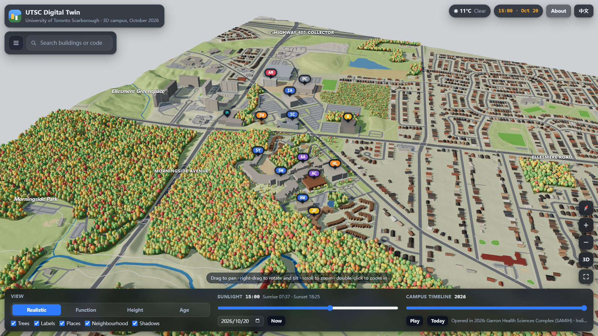

# 多伦多大学士嘉堡校区数字孪生 · UTSC Digital Twin

A browser-based 3D model of the whole University of Toronto Scarborough campus as it stands in
October 2026, on real lidar terrain, rendered with three.js. The page opens in English; one click
switches everything to Chinese.

**Live:** https://felixjiashengfu.github.io/utsc-digital-twin/



## What it does

- **The latest campus**: all 53 campus buildings mapped in OpenStreetMap, including the newest:
  Harmony Commons (2023), the Sam Ibrahim Building (2024), Indigenous House (May 2026), the Garron
  Health Sciences Complex for SAMIH (students since fall 2026) and the Retail and Parking Commons
  (parking open 2026). Around them: 3,000 neighbourhood buildings, roads and paths, Highland Creek,
  and 32,000 trees.
- **Real ground**: the Government of Canada's HRDEM lidar terrain model (2 m, resampled to a 4 m mesh),
  so the Highland Creek ravine, the valley fields and the Morningside crossing have their true shape,
  and buildings sit on the slopes they are built into.
- **Smooth zoom**: every wheel notch, pinch or button press eases out over about a quarter of a second
  (frame-rate independent) and zooms about the exact point under the cursor. The automated check
  measures a 0.1 px drift of that point, and no frame of a zoom carries more than ~11% of it. If a
  device cannot keep up, the page lowers its render resolution rather than its frame rate.
- **Walking time to anywhere**: click or tap any spot (a building, a lawn, a parking lot) to see how
  long the walk takes from the start point, the UTSC bus loop by default. The route is drawn on the
  map, the card gives minutes, distance and climb, and hovering shows the time before you click. Drag
  the green pin, use *Set start*, *Walk from here* or your own location to move the start; the
  *Walk-time map* colours every path by minutes from the start. Routes follow OpenStreetMap footways,
  sidewalks, crossings, stairs and indoor corridors (2,257 junctions, 3,132 segments) and are timed with
  Tobler’s hiking function on the lidar terrain: about 5 km/h on the level, slower uphill and on stairs,
  so the climb out of the Highland Creek valley takes longer than the walk down. Waiting at crossings
  is not counted.
- **Real sun and live weather**: sun position for the campus at any date and time, with shadows,
  sunrise and sunset, lit windows and street lights at night, and the season's tree colours;
  current conditions from Open-Meteo.
- **Views**: realistic, function, height and year-opened colourings; a campus timeline from 1962 to
  2026 in which buildings rise in the year they opened; a guided tour of what is new in 2023–26.
- **Inspect and search**: click any building for its code on the official UTSC map, opening year,
  floors, height and where that height comes from, footprint, ground elevation, architects, and a
  short description checked against U of T, UTSC and news sources, in both languages. Search by name
  or code; links like `#IC` open a building directly.
- **English / 中文**: the page always opens in English, whatever the browser language; the button in
  the top-right corner switches labels, panels and cards to Chinese. `?lang=zh` opens in Chinese.

Heights use published figures where they exist (SAMIH 32 m, Sam Ibrahim Building 27.1 m, Retail
and Parking Commons 23.5 m), otherwise OpenStreetMap floor counts (4.0 m per floor, 3.1 m in
residences), otherwise an estimate; the info card says which. Trees inside mapped woodland (most of
the valley forest) are placed procedurally; individually mapped trees keep their positions. Window
patterns and street lights are illustrative.

## Layout

```
tools/fetch.mjs      download OpenStreetMap (Overpass) and the HRDEM terrain into data/raw/ (not in git)
tools/curated.mjs    checked facts per building: codes, names in both languages, years, descriptions, sources
tools/process.mjs    project, clean and classify → data/campus.json + data/terrain.bin
tools/build.mjs      copy src/ and data/ into dist/ with content-hashed URLs
tools/serve.mjs      local static server for dist/
tools/qa.mjs         automated browser checks (headless Chrome): language default, zoom smoothness,
                     picking, walking routes, timeline, phone layout; writes qa/report.json and screenshots
src/                 the viewer: app.js, controls.js (camera), world.js (scene), walk.js (walking routes),
                     sky.js, labels.js, i18n.js
src/vendor/          three.js r170 (MIT), served from the site itself so no CDN is needed
dist/                the published site; .github/workflows/pages.yml deploys it on every push to main
```

## Rebuild

The tools are plain ES modules and run under Deno or Node 20+.

```sh
deno install                                  # geotiff, playwright-core
deno run -A tools/fetch.mjs                   # raw OSM + terrain → data/raw/
deno run -A tools/process.mjs                 # → data/campus.json, data/terrain.bin
deno run -A tools/build.mjs                   # → dist/
deno run -A tools/serve.mjs                   # http://localhost:8642/
deno run -A --unsafe-proto tools/qa.mjs       # 24 automated checks
```

## Controls

Click or tap anywhere for the walking time · drag to pan · right-drag (or Shift/Ctrl-drag) to rotate and tilt · scroll or pinch to zoom ·
double-click to zoom in · two-finger twist to rotate · arrow keys pan, `+`/`-` zoom, `Q`/`E` rotate ·
`/` focuses search · `Esc` clears the selection.

## Data and licences

- Map data © OpenStreetMap contributors, under the [Open Database License](https://opendatacommons.org/licenses/odbl/);
  the derived dataset in `data/campus.json` (and in `dist/`) is likewise available under the ODbL.
- Terrain: Natural Resources Canada, High Resolution Digital Elevation Model (HRDEM). Contains
  information licensed under the [Open Government Licence – Canada](https://open.canada.ca/en/open-government-licence-canada).
- Building codes from the UTSC campus map (v18, 2024); the facts in `tools/curated.mjs` list their sources.
- Live weather from [Open-Meteo](https://open-meteo.com/) (CC BY 4.0).
- three.js © three.js authors, MIT licence (`src/vendor/THREE-LICENSE.txt`).

Unofficial project, not affiliated with the University of Toronto.
